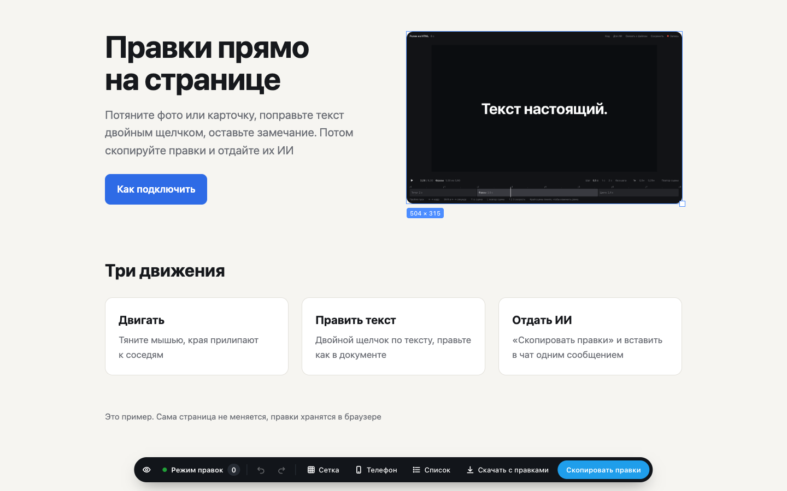

# Режим правок

Двигайте фото и блоки, правьте текст и оставляйте замечания прямо на HTML-странице, а потом скачайте готовый файл или отдайте всё ИИ одним сообщением. Для сайтов и презентаций. Без установки программ

## Попробовать без скачивания

Сайт пакета https://tomb-raider.github.io/rezhim-pravok/

- [Пример страницы](https://tomb-raider.github.io/rezhim-pravok/%D0%9F%D1%80%D0%B8%D0%BC%D0%B5%D1%80.html?pravki) с включённым режимом
- «Открыть папку»: ваша презентация или сайт откроется прямо на сайте пакета уже в режиме правок, файлы остаются в браузере
- фраза для агента: агент сам возьмёт режим отсюда и откроет вашу страницу
- кнопка-закладка: перетащите её на панель закладок, и режим включается на открытой странице. Если сайт не пускает закладку, она скажет об этом

## Что умеет

- тянуть мышью фото, блоки и текст, края прилипают к соседям и к сетке: клетка или колонки по кнопке «Сетка». Сдвинутый блок ложится поверх соседей, они остаются на местах
- менять размер за квадратик в углу
- править текст двойным щелчком прямо на странице
- Alt + щелчок оставляет замечание к чему угодно
- Delete убирает выбранный блок
- назад и вперёд по правкам и сдвигам, история не теряется при перезагрузке
- показывать страницу с правками на ширине телефона
- «Скопировать правки» отдаёт всё одним текстом для ИИ: что было и что стало, куда и насколько сдвинуто, к чему выровнено
- «Скачать с правками» без ИИ: скачивается тот же файл, где уже стоят сдвиги, размеры и новый текст. Несколько страниц скачиваются архивом. Замечания словами остаются для ИИ

Сама страница не меняется. Правки хранятся в браузере, а в файлы их вносит ИИ или кнопка «Скачать с правками»

## Как скачать

Нажмите зелёную кнопку «Code», затем «Download ZIP», распакуйте двойным щелчком. Для закладки скачивать ничего не нужно

## Инструкции

- [Как пользоваться](https://github.com/Tomb-Raider/rezhim-pravok/blob/main/%D0%9A%D0%B0%D0%BA%20%D0%BF%D0%BE%D0%BB%D1%8C%D0%B7%D0%BE%D0%B2%D0%B0%D1%82%D1%8C%D1%81%D1%8F.md) как включить режим и как отдать правки ИИ
- [Инструкция для ИИ](https://github.com/Tomb-Raider/rezhim-pravok/blob/main/%D0%98%D0%BD%D1%81%D1%82%D1%80%D1%83%D0%BA%D1%86%D0%B8%D1%8F%20%D0%B4%D0%BB%D1%8F%20%D0%98%D0%98.md) первое сообщение в чат или `CLAUDE.md` для агента

Лицензия MIT

Соседний пакет [Ролик из HTML](https://github.com/Tomb-Raider/rolik-iz-html) собирает короткий ролик из HTML с любым ИИ
